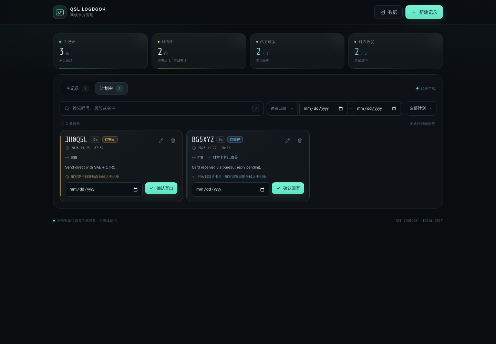
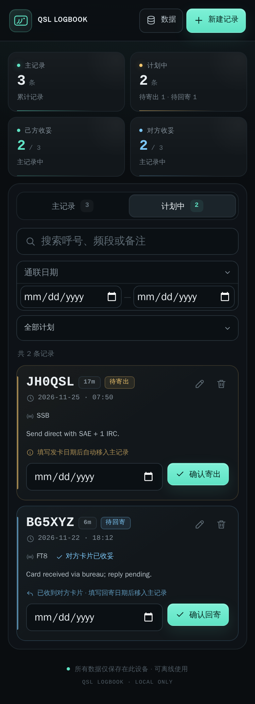

# QSL LOGBOOK

**离线优先的 QSL 卡片与通联日志管理工具。**  
纯 HTML / CSS / JavaScript PWA，另附一个把同一套页面打包进 APK 的 Android WebView 壳层。

无后端、无图片上传、无外部依赖，所有记录只保存在本机。

- APK 下载：[Releases](https://github.com/BD1CKD/qsl-logbook/releases/latest)




## 功能

- **主记录 / 计划中**两个分页。
- 计划中区分 **待寄出**（准备先寄卡）和 **待回寄**（已收到对方卡片，等待回寄）。
- 选择“待回寄”会自动标记“对方卡片已收妥”，计划中可按待寄出 / 待回寄筛选。
- **两步录入**：先填通联日期、时间、对方呼号、频段或卫星，再填发卡 / 回寄日期、收妥状态、模式和备注。
- 主记录必须填写寄出日期；计划中的记录补上日期后自动移入主记录。
- 主记录卡片上有 **己方卡片收妥 / 对方卡片收妥** 快捷开关。
- 搜索与筛选：呼号、频段、卫星、模式、备注；通联日期 / 发卡日期范围；收妥状态；计划类型。
- **备份与迁移**：完整 JSON、ZIP（JSON + CSV + README）或 CSV；支持合并 / 替换导入。
- **PWA**：可安装、Service Worker 离线缓存、暗色主题、手机与桌面自适应。
- **离线 APK**：内置全部资源，不依赖浏览器安装规则或本地服务器。

## 快速开始：Web 版

PWA 的 Service Worker 需要 HTTP(S) 或 localhost，不能直接双击 `index.html` 安装。

```bash
# 在仓库根目录
python3 -m http.server 8080
```

打开 <http://localhost:8080>。

## Android APK

Android 壳层源码在 [`android/`](android/README.md)。它把 Web 资源作为 `assets` 打包，使用 `WebView` 加载，因此：

- 完全离线，无需启动本地服务器；
- 导入备份使用系统文件选择器；
- 导出文件写入 `Download/QSL LOGBOOK/`；
- 返回键会先关闭已打开的弹窗。

预编译 APK 见 **Releases**。构建方式：

```bash
cd android
ANDROID_JAR=/path/to/android-29/android.jar ./build.sh
```

首次构建会生成签名密钥 `android/build/qsl-logbook.keystore`，该文件不会提交到 Git；后续发布更新时请继续使用同一个密钥。

## 数据与备份

- 网页版存储键：`qsl-logbook-v1`（按浏览器 / origin 独立）。
- APK 使用独立的 App 内 `localStorage`；与网页版、Edge 快捷方式的数据互不相通。
- 换设备或清理浏览器数据前，请先导出完整备份。
- ZIP 包内容：`qsl-backup.json`、`qsl-records.csv`、`README.txt`。
- 合并导入按记录 ID 去重，保留更新时间较新的版本；替换导入会清空当前数据并再次确认。

## 目录结构

```text
.
├── index.html / styles.css / app.js / zip.js   # Web 应用
├── sw.js / manifest.webmanifest / icons/       # PWA
├── android/                                    # Android WebView 壳层
│   ├── AndroidManifest.xml
│   ├── src/com/dsh/qsllog/MainActivity.java
│   ├── res/
│   └── build.sh
└── docs/                                       # README 预览图
```

## 隐私

- 没有后端，所有数据仅在本机。
- 没有图片上传，也不会向网络发送记录。
- 备份文件由用户在本机生成，是否分享由用户决定。

## License

[MIT](LICENSE)
